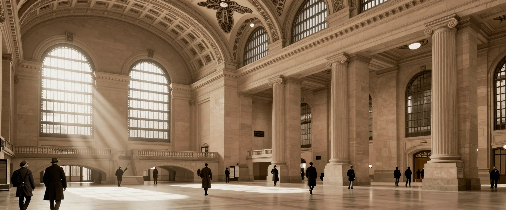
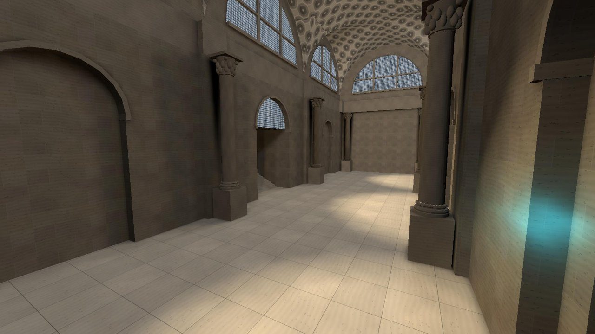
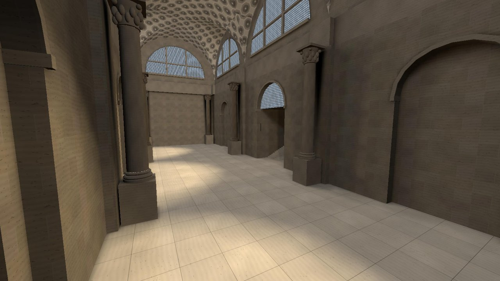
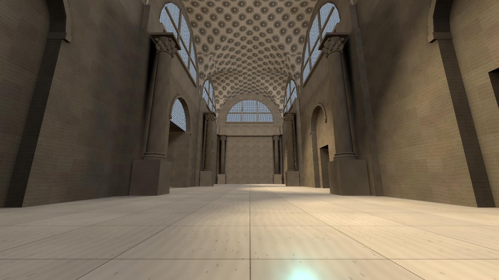
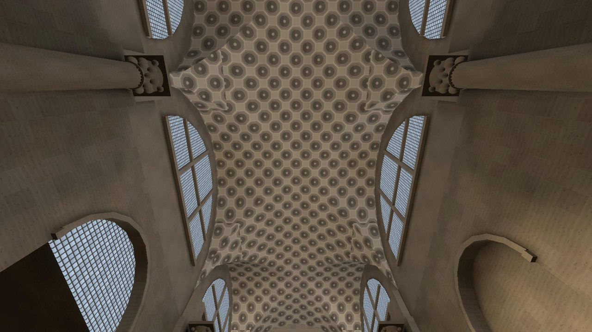
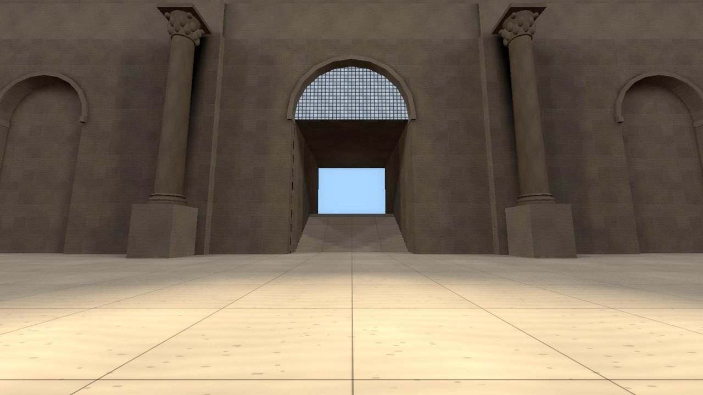
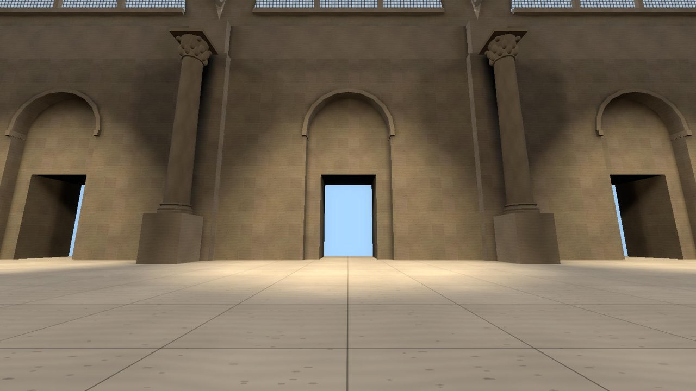

# gm_penn_station

**Play it:** [Steam Workshop: Penn Station 1910 (gm_penn_station)](https://steamcommunity.com/sharedfiles/filedetails/?id=3846546331)

A Garry's Mod map of the 1910 Pennsylvania Station in New York (McKim, Mead & White), built at true scale (1 ft = 12 units). The station was torn down in 1963; this map rebuilds it from public-domain photographs and plans.

Release 0.1.0 has the main waiting room: three groin-vaulted bays 150 ft to the crown, coffered vaults, Corinthian columns on tall pedestals, thermal windows in every lunette with morning sun on the floor, and the grand stair up to the arcade. The arcade, the train concourse, the platforms and the Seventh Avenue front come after it (see the [plan](ai-docs/plans/penn-gmod-plan.md)).

The map is written as VMF text by a Python script, not drawn in Hammer. The textures (travertine, coffers, floor, window glass) and the column model are made by scripts in `tools/`.

Screenshots from release 0.1.0:

| | |
|---|---|
|  |  |
|  |  |
|  |  |

### Level map


## Build

Needs Garry's Mod (set `GMOD` if it is not in `D:/SteamLibrary/steamapps/common/GarrysMod`), Python 3 with Pillow, and Git Bash.

```sh
sh tools/compile.sh          # VMF, textures, models, vbsp/vvis/vrad, pack, copy to garrysmod/maps
UNCAP=1 sh tools/shots.sh    # screenshots and fps into shots/
python tools/make_map.py     # docs/level-map.png
```

## Credits and licence

- Reference photos and plans: public domain, from Wikimedia Commons and the Library of Congress (list in [refs/SOURCES.md](refs/SOURCES.md)). Used for proportions and colour only.
- Stock Half-Life 2 materials ship with Garry's Mod and are not bundled.
- The banner above was made with the Z-Image Turbo model (Apache-2.0) and is AI art, not a screenshot. No AI images are in the map.
- Tools: MIT ([LICENSE](LICENSE)). Map source and textures: CC BY-SA 4.0.
