# gm_penn_station

**Play it:** [Steam Workshop: Penn Station 1910 (gm_penn_station)](https://steamcommunity.com/sharedfiles/filedetails/?id=3846546331)

A Garry's Mod map of the 1910 Pennsylvania Station in New York (McKim, Mead & White), built at true scale (1 ft = 12 units). The station was torn down in 1963; this map rebuilds it from public-domain photographs and plans.

Release 0.5.0 adds the outside of the station: the full Seventh Avenue front with 32 Doric columns between corner pavilions, the raised central pavilion with its clock group and stone eagles, and the 31st and 33rd Street fronts with pilastered walls, carriage drives behind Doric colonnades and arched gables over thermal windows, lit by street lamps. Release 0.4.0 added the track level: six island platforms with stone coping, steel columns and hanging lamps under the concourse, seven tracks running west to the tunnel portals, and two trains of Tuscan red coaches behind DD1 electrics lettered PENNSYLVANIA. Release 0.3.0 added the train concourse: three glass groin vaults about 100 ft high on branching steel lattice columns and truss ribs, a travertine arcade and clock on the east wall, and six stairs down toward the tracks. Release 0.2.0 added the Seventh Avenue front: the Doric colonnade on the street, the entrance vestibule and the 225 ft shopping arcade with bronze shopfronts, groin vaults and lamp standards, down to the Cassatt statue niche at the head of the grand stair. Release 0.1.0 had the main waiting room: three groin-vaulted bays 150 ft to the crown, coffered vaults, Corinthian columns on tall pedestals, thermal windows in every lunette with morning sun on the floor. Extras such as the dining room and a nav mesh come next (see the [plan](ai-docs/plans/penn-gmod-plan.md)).

The map is written as VMF text by a Python script, not drawn in Hammer. The textures (travertine, coffers, floor, window glass, shopfronts, paving) and the models (columns, lamps, statue, steel lattice columns and roof ribs, clock, train) are made by scripts in `tools/`.

Screenshots from release 0.5.0:

| | |
|---|---|
| 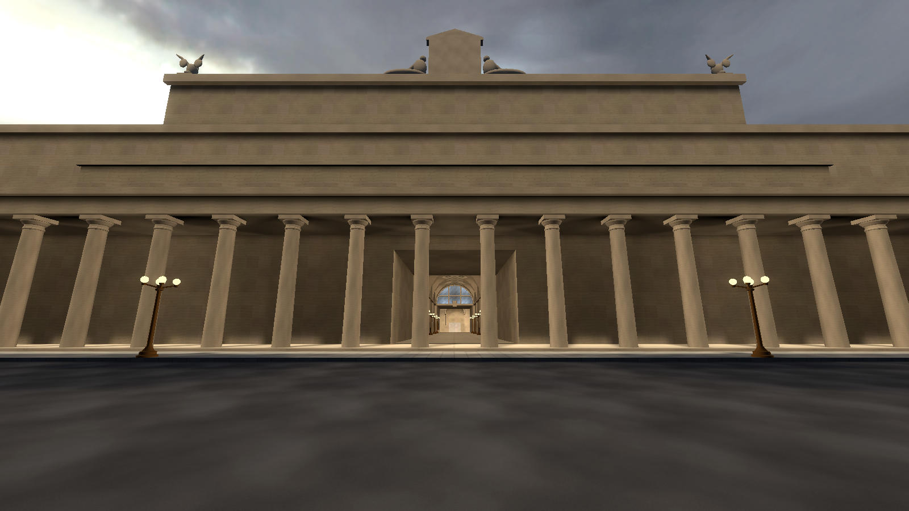 | 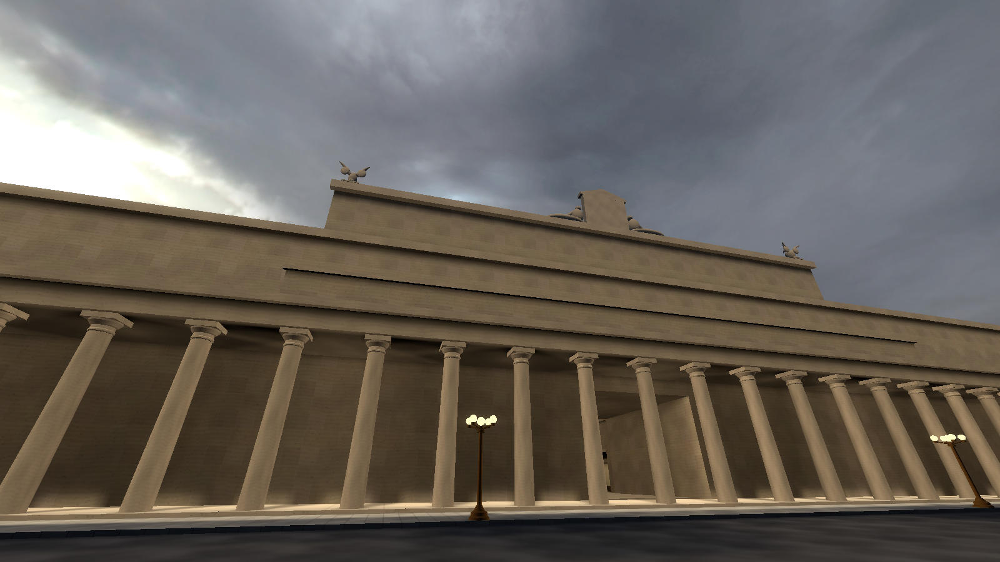 |
| 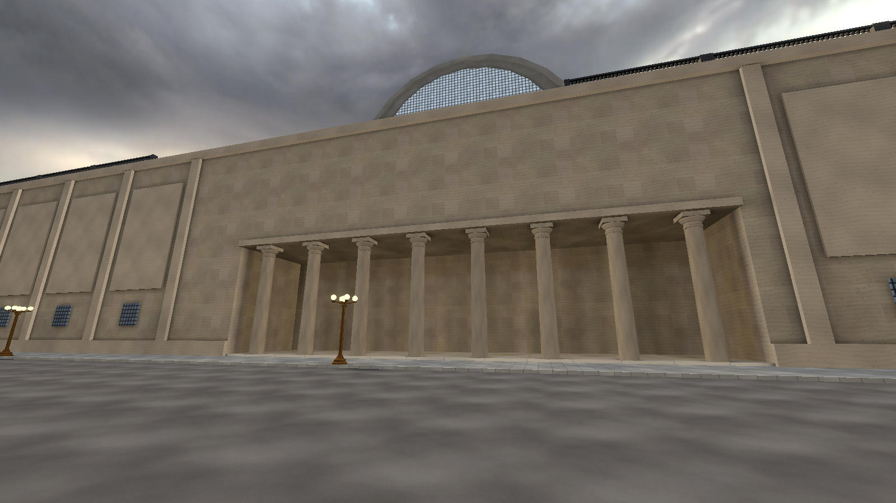 | 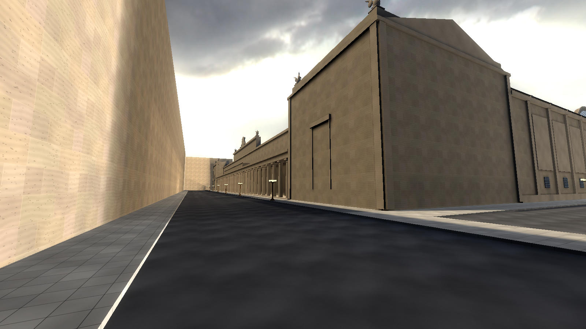 |
| 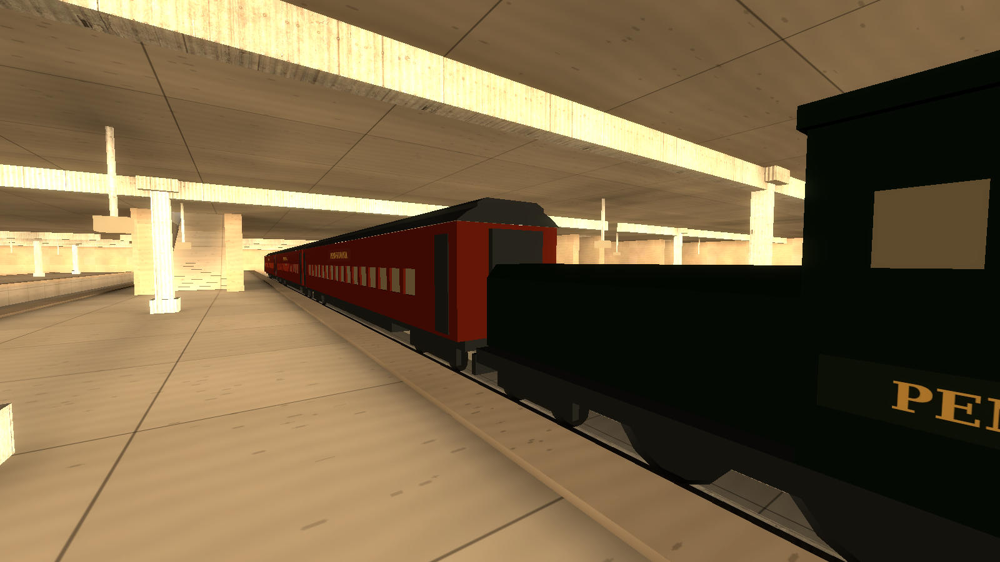 | 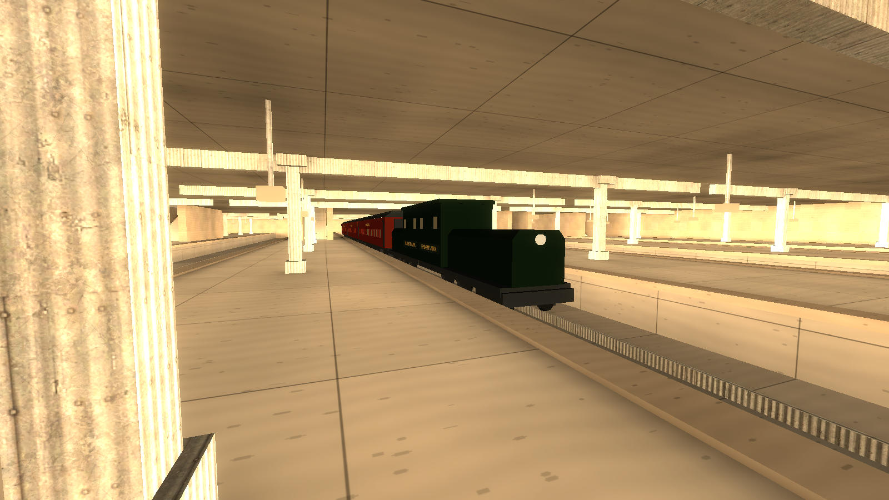 |
| 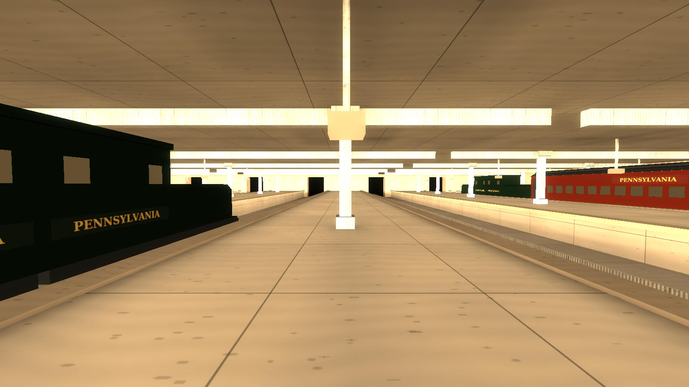 | 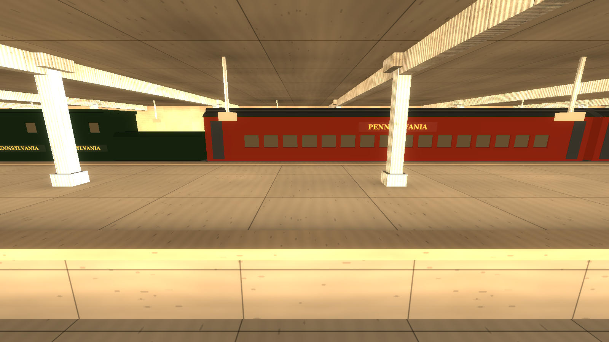 |
| 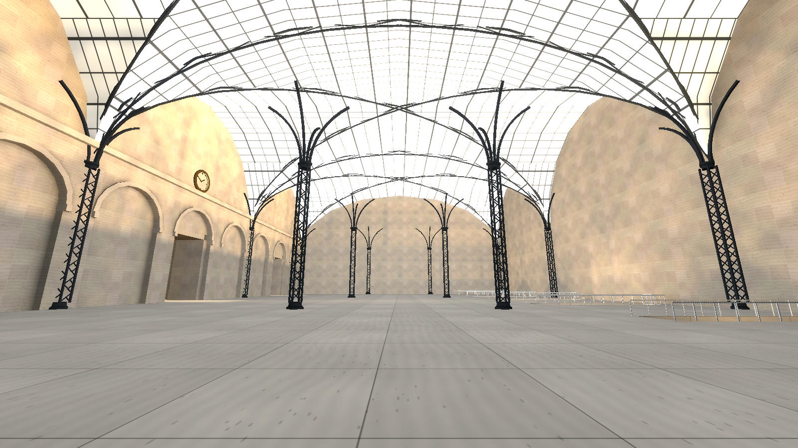 | 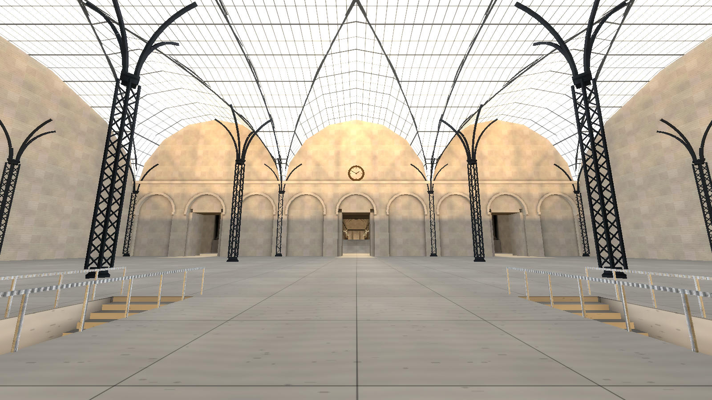 |
| 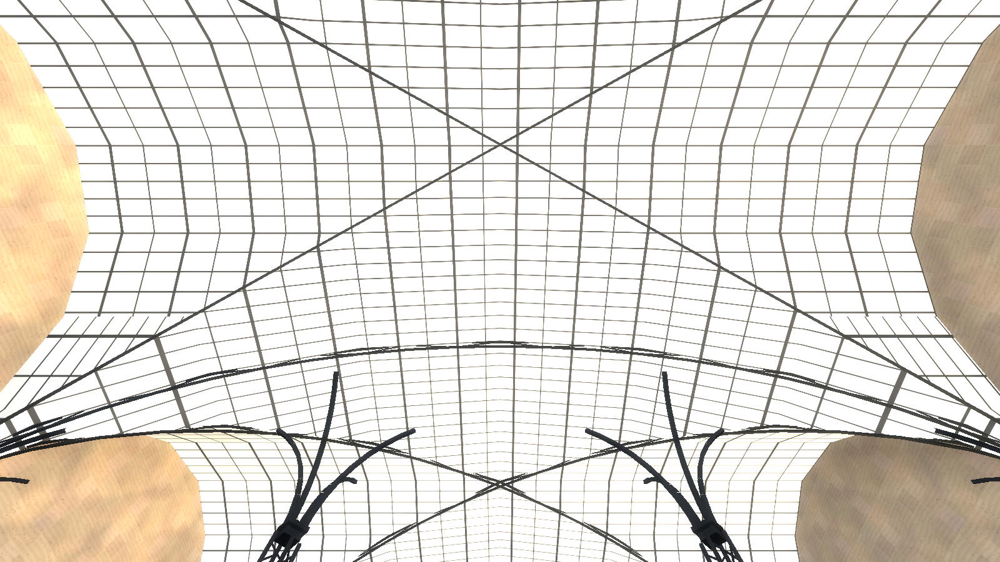 | 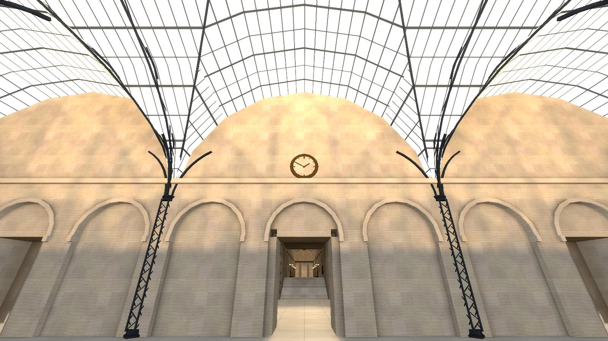 |
| 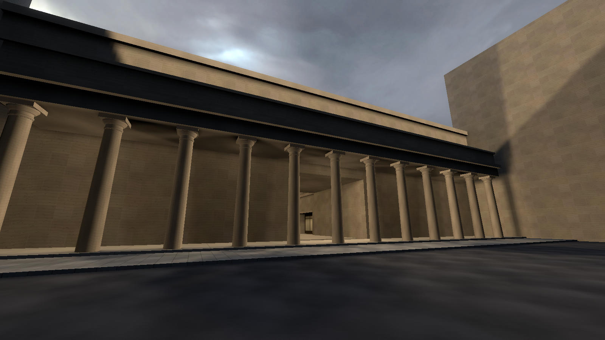 | 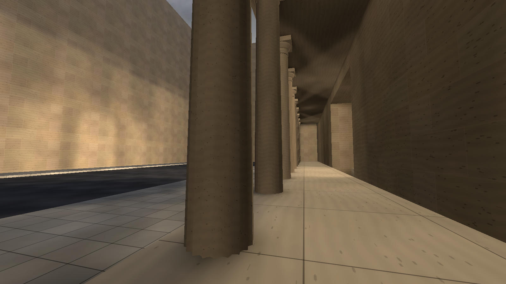 |
| 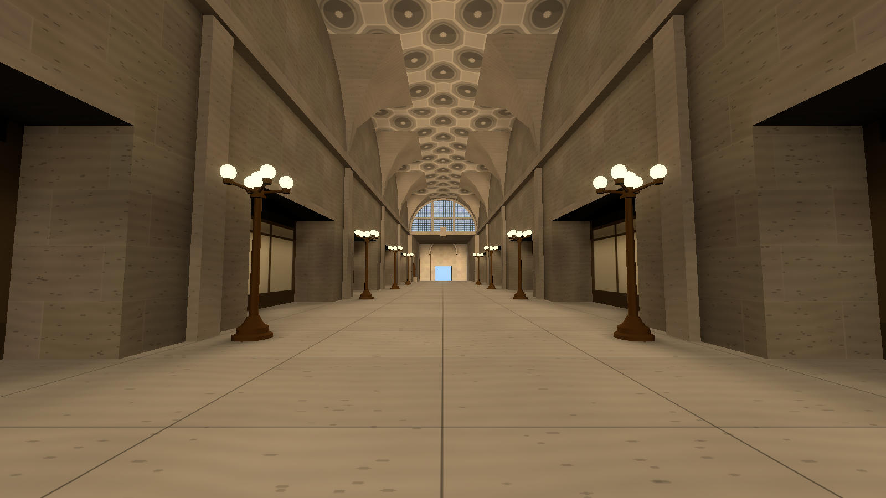 | 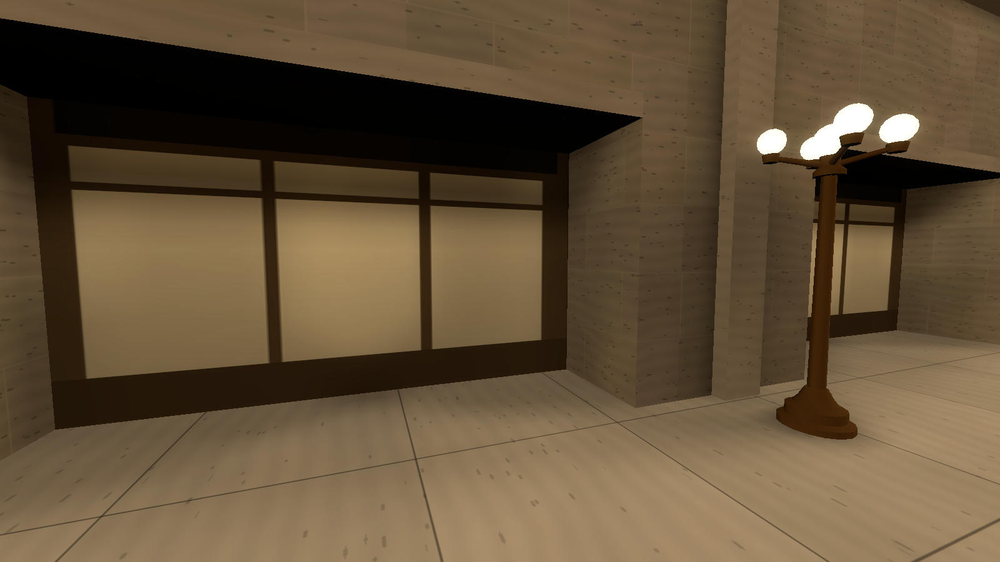 |
| 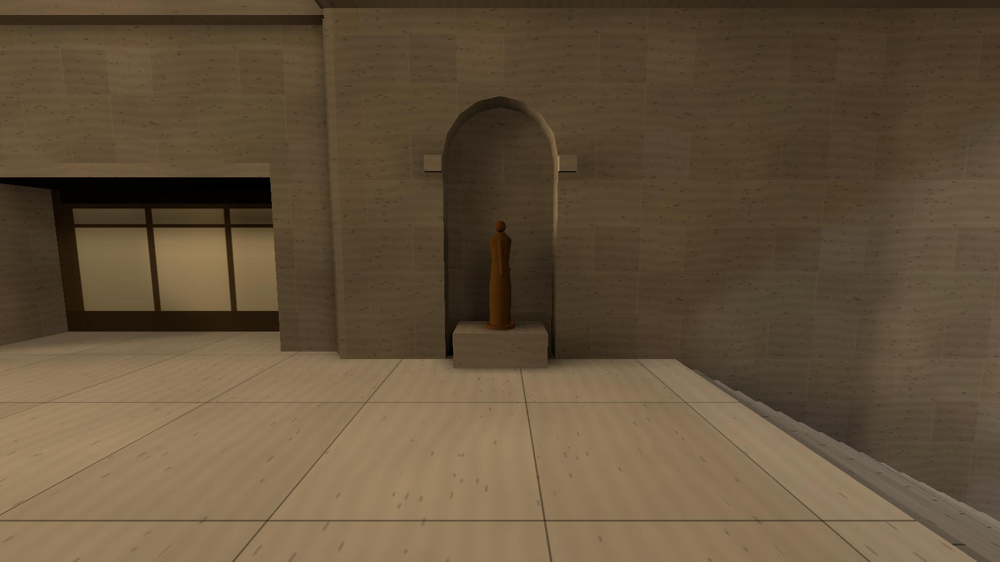 |  |
|  |  |

### Level map

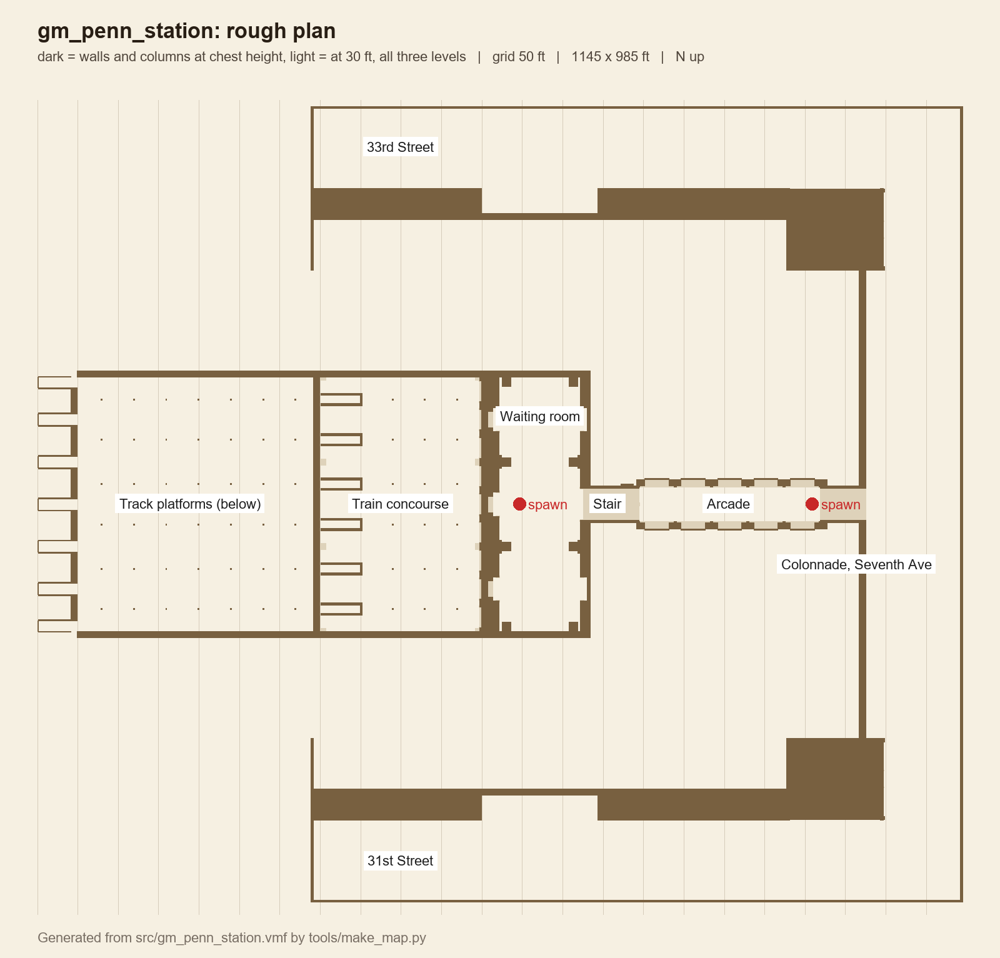

## Build

Needs Garry's Mod (set `GMOD` if it is not in `D:/SteamLibrary/steamapps/common/GarrysMod`), Python 3 with Pillow, and Git Bash.

```sh
sh tools/compile.sh          # VMF, textures, models, vbsp/vvis/vrad, pack, copy to garrysmod/maps
UNCAP=1 sh tools/shots.sh    # screenshots and fps into shots/
python tools/make_map.py     # docs/level-map.png
```

## Credits and licence

- Reference photos and plans: public domain, from Wikimedia Commons and the Library of Congress (list in [refs/SOURCES.md](refs/SOURCES.md)). Used for proportions and colour only.
- Stock Half-Life 2 materials ship with Garry's Mod and are not bundled.
- The banner above was made with the Z-Image Turbo model (Apache-2.0) and is AI art, not a screenshot. No AI images are in the map.
- Tools: MIT ([LICENSE](LICENSE)). Map source and textures: CC BY-SA 4.0.
