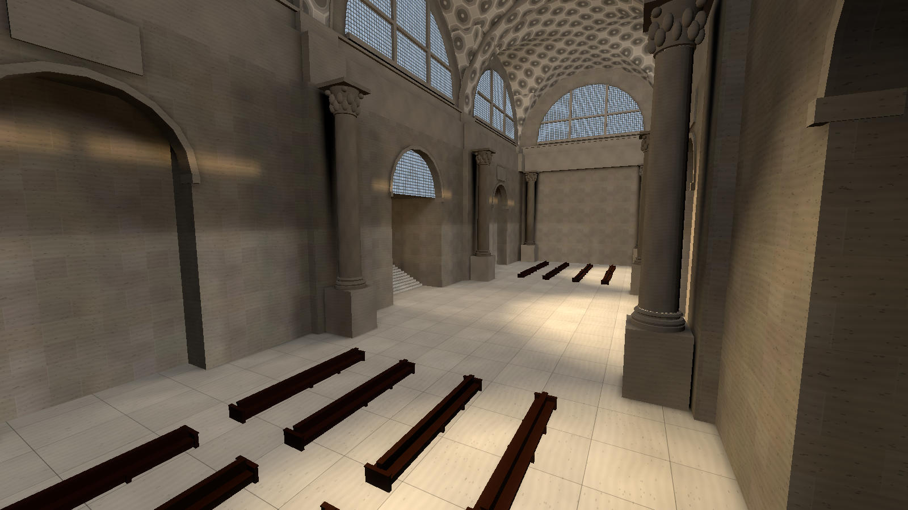

gm_penn_station is a Garry's Mod map of the 1910 Pennsylvania Station in New York (McKim, Mead & White), built at true scale (1 ft = 12 units). The station was torn down in 1963; the map rebuilds it from public-domain photographs and plans.

**Play it:** [Steam Workshop item 3846546331](https://steamcommunity.com/sharedfiles/filedetails/?id=3846546331)

The map isn't drawn in Hammer. A Python script, `tools/build_vmf.py`, writes the whole VMF as text, and other scripts draw every custom texture and build every model.

## Pages

- [Building the map](Building-The-Map): what you need, compiling, and loading it in game
- [Tools](Tools): what each script in `tools/` does
- [Reference photos and accuracy](Reference-Photos-And-Accuracy): the sources, their licences, and what is still an estimate
- [Roadmap](Roadmap): the areas, in build order
- [Changelog](Changelog): what each release added

## Status

Release 0.7.2 has every area in the plan: the waiting room, the Seventh Avenue arcade and colonnade, the train concourse, the track level with two trains, the outside of the station, the dining room and lunch room, and a nav mesh. Whether Moynihan Train Hall belongs here is still open.
